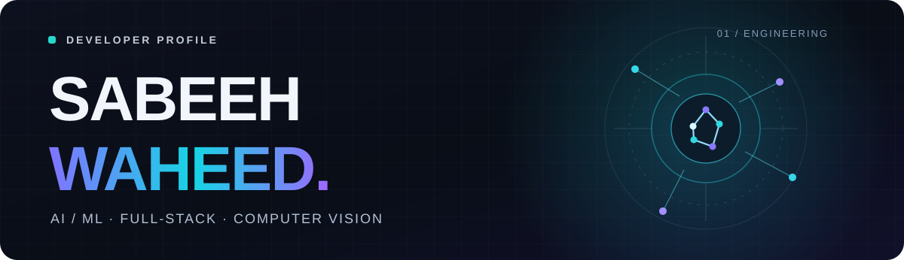
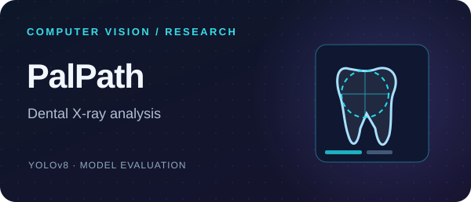
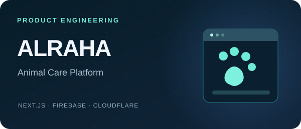
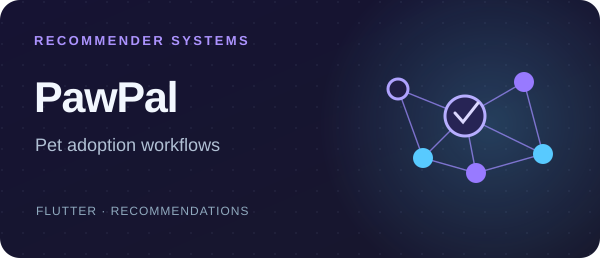
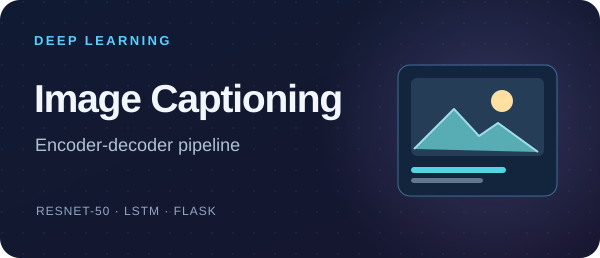

 

 
 

 

## The short version

I'm a Computer Science graduate who enjoys the entire engineering process: taking an idea, experimenting with models, building the application around it, and making it useful for real people.

**My focus:** computer vision, practical machine learning, recommendation systems, and full-stack products. Recent work spans dental X-ray analysis, pet-care software, and applications built with Python, Flutter, React, and Next.js.

> **I care about what happens after the model works:** interfaces, APIs, evaluation, and the details that make software usable.

## Selected work

<table>
  <tr>
    <td width="50%" valign="top">
      
      <h3>PalPath</h3>
      
Dental X-ray analysis project using computer vision. A closer look at model development, validation, and the interface around AI-assisted image analysis.

      <code>YOLOv8</code> <code>Computer Vision</code> <code>Evaluation</code>
        
      <a href="https://sabeeh-portfolio.sabeehwd1786.workers.dev/#projects">View case study</a>
    </td>
    <td width="50%" valign="top">
      
      <h3>ALRAHA Animal Care</h3>
      
Veterinary-services website with appointment and commerce-oriented flows, built as a user-facing web product and deployed on Cloudflare.

      <code>Next.js</code> <code>Firebase</code> <code>Cloudflare</code>
        
      <a href="https://alrahaanimalcare.com">Visit live website</a>
    </td>
  </tr>
  <tr>
    <td width="50%" valign="top">
      
      <h3>Pet Adoption / PawPal</h3>
      
Flutter-based pet-adoption application and recommendation-oriented workflows connecting users with suitable pets.

      <code>Flutter</code> <code>Recommendation Systems</code>
        
      <a href="https://github.com/Sabstar71/Pet_Adoption_app">Explore repository</a>
    </td>
    <td width="50%" valign="top">
      
      <h3>Image Caption Generator</h3>
      
Image-to-text application with a ResNet-50 feature encoder, LSTM decoder, and Flask-based inference interface.

      <code>PyTorch</code> <code>ResNet-50</code> <code>LSTM</code>
        
      <a href="https://github.com/Sabstar71/Image-Caption-Generator">Explore repository</a>
    </td>
  </tr>
</table>

### More things I've built

| Project | Engineering focus |
| :--- | :--- |
| [Career Recommendation System](https://github.com/Sabstar71/DecodeLabs_Projects/tree/main/Project%203) | NLP, embeddings, similarity-based ranking |
| [Collaborative Whiteboard](https://github.com/Sabstar71/White_Board_with_live_chat) | React, Node.js, Socket.IO, real-time collaboration |
| [Netflix Recommendation & Analytics](https://github.com/Sabstar71/Netflix_Movie_Recommendor) | Recommendation and data-analysis experiments |
| [Waste Collection Map](https://github.com/Sabstar71/BDA-Lab/tree/main/BDA-project) | WebSockets, Leaflet, Hadoop / HDFS |
| [Disease-Symptom Prediction](https://github.com/Sabstar71/Disease-Symptom-Prediction) | TF-IDF, random-forest classification, Flask |

## The toolkit

<table>
  <tr><td width="25%"><b>AI / ML</b></td><td>PyTorch · scikit-learn · OpenCV · Pandas · NumPy · YOLOv8</td></tr>
  <tr><td><b>Frontend / Mobile</b></td><td>React · Next.js · TypeScript · Flutter · Dart</td></tr>
  <tr><td><b>Backend / Cloud</b></td><td>Python · Flask · REST APIs · Firebase · Cloudflare · Docker</td></tr>
  <tr><td><b>Workflow</b></td><td>Git · GitHub · Linux · Jupyter · VS Code</td></tr>
</table>

## Currently exploring

Working on deeper expertise in **LLMs, retrieval-augmented generation, AI agents, and dependable model evaluation** — particularly how to connect research prototypes to useful applications.

<b>GitHub activity</b> — expand to view

 

---

**Let's build something useful.**

[Portfolio](https://sabeeh-portfolio.sabeehwd1786.workers.dev) · [LinkedIn](https://www.linkedin.com/in/sabeeh-waheed-865a25179/) · [Email](mailto:sabeehwd1786@gmail.com) · [All repositories](https://github.com/Sabstar71?tab=repositories)

